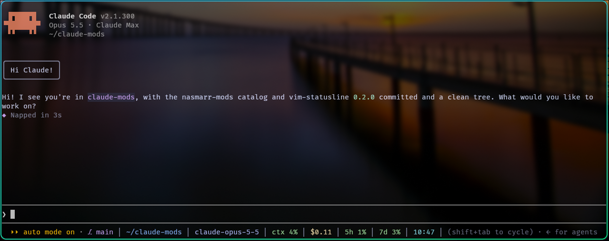

# vim-statusline

A Neovim-style status line for Claude Code, in Catppuccin Mocha colors. It
replaces the hint line under the prompt:



With every segment showing:

```
⎇ main ●3 ↑1 │ ~/proj │ Opus 5.5 │ ctx 42% │ $0.31 │ 5h 20% │ 7d 55% │ 14:05
```

| Segment | Shows |
| --- | --- |
| `⎇ main ●3 ↑1 ↓2` | Git branch, changed files, commits ahead / behind |
| `~/proj` | Current folder |
| `Opus 5.5` | Model |
| `ctx 42%` | Context window used, green → yellow → peach → red as it fills |
| `$0.31` | Session cost (when available) |
| `5h 20%` `7d 55%` | Usage limits, colored the same way |
| `14:05` | Time, refreshed every 30 seconds |

In a narrow window it gives up the least useful parts first: the hint text,
then the time, then the folder's parent path (`~/work/proj` → `proj`). It
refits as you resize.

It refreshes on session start, after each turn, after Bash/Edit/Write tool
calls (so branch switches show up), and on the clock.

## Install

```
/plugin marketplace add nasmarr/claude-mods
/plugin install vim-statusline@nasmarr-mods
```

## Notes

- Colors are Catppuccin Mocha and look best on a dark terminal background.
- The glyphs (`⎇ ● ↑ ↓ │`) are plain Unicode, so no special font is needed.
